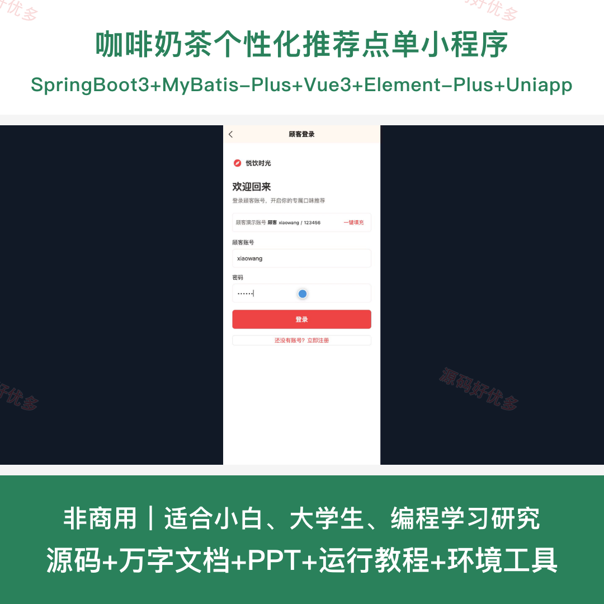
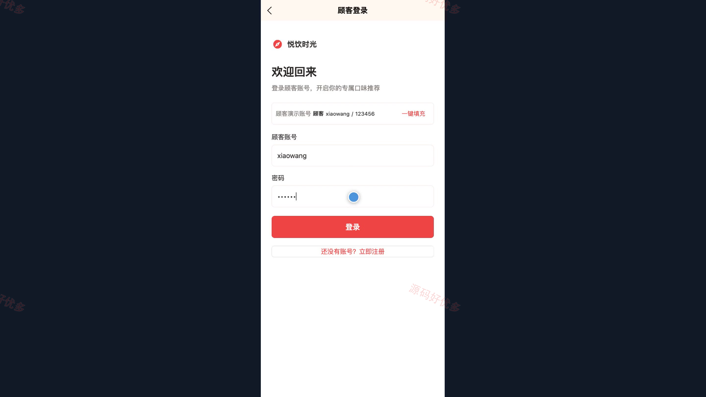
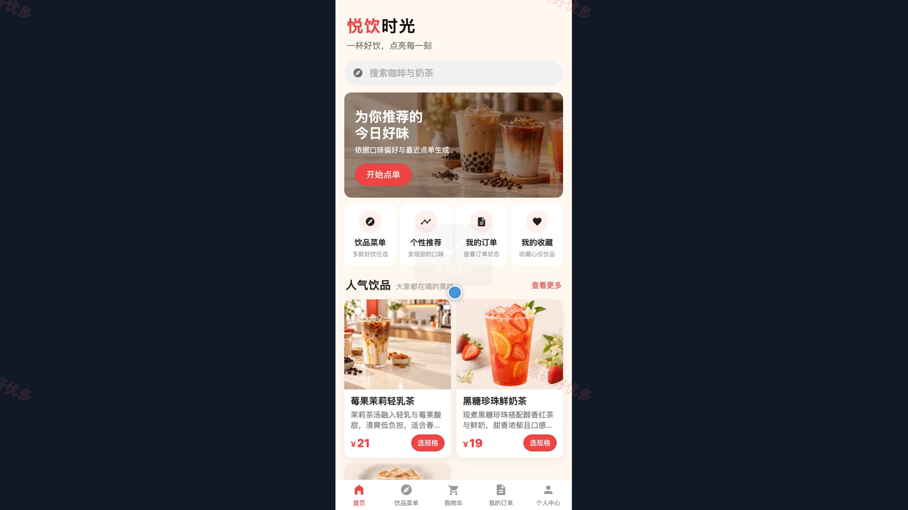
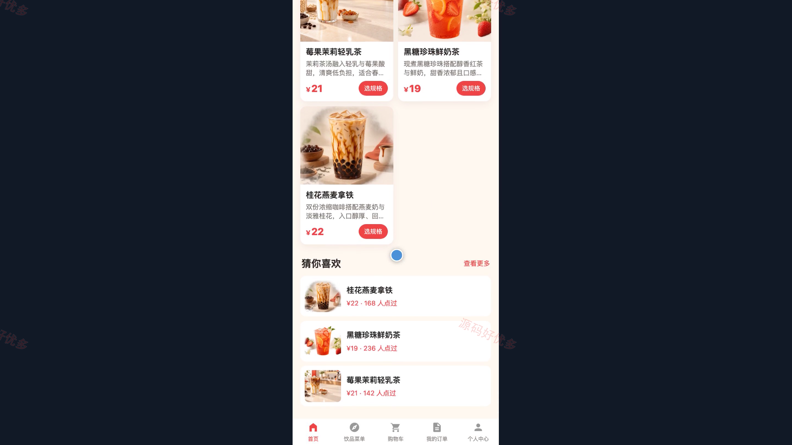
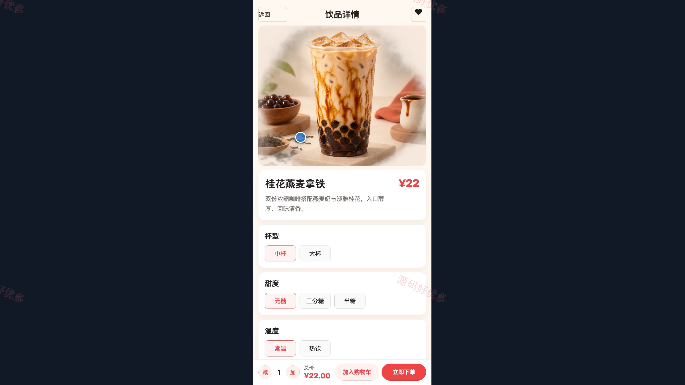
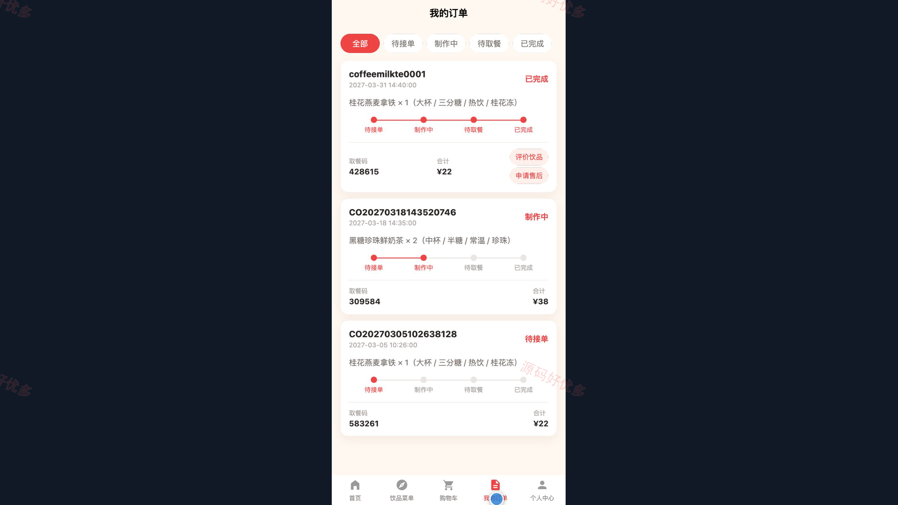
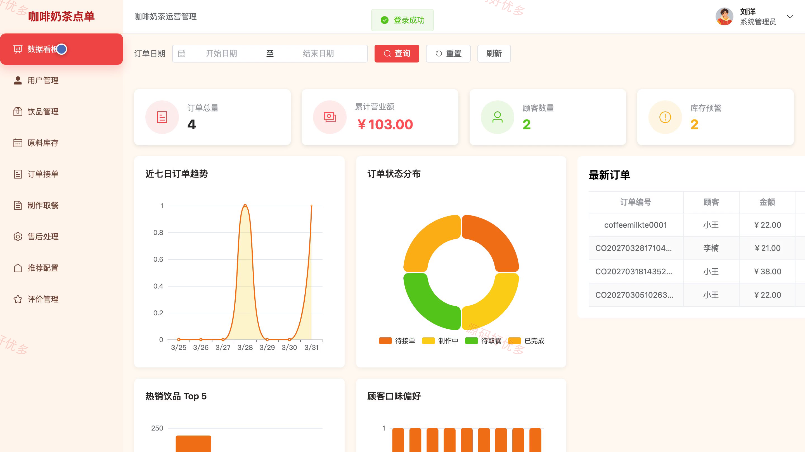
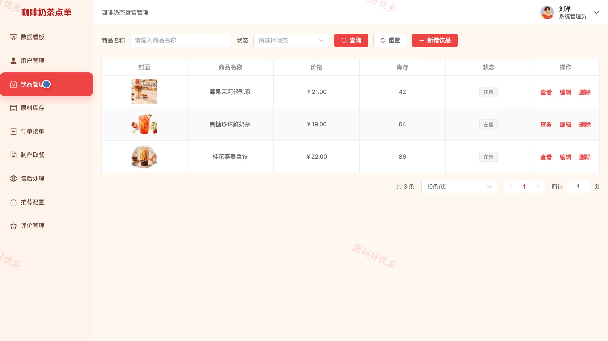
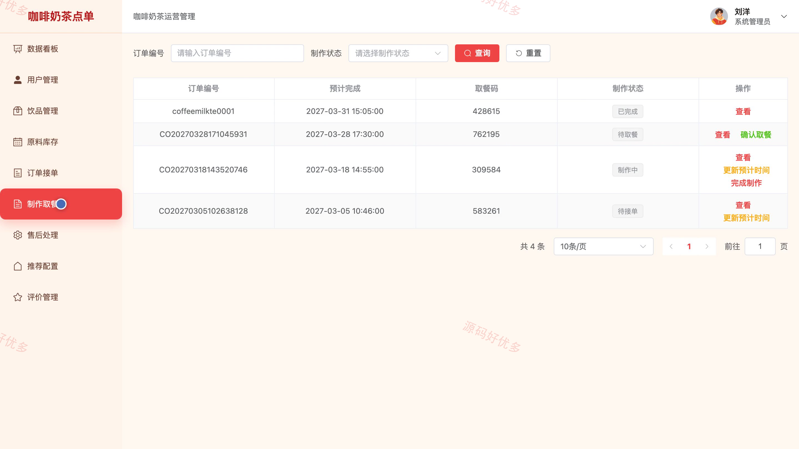

## 源码问题查看主页咨询

### 一、关键词
咖啡奶茶、饮品点单、个性推荐、在线点餐、自助取餐

### 二、作品包含
源码+数据库+万字设计文档+PPT+全套环境和工具资源+本地部署教程

### 三、项目技术
前端技术： Html、Css、Js、Vue3.4、Element-Plus、uniapp
后端技术：Java、SpringBoot3.2.0、MyBatis-Plus

### 四、运行环境要求
开发工具：IDEA/eclipse + VSCODE + HBuilder X + 微信开发者工具

数据库：MySQL5.7+（共14张表）

数据库管理工具：Navicat10以上版本

环境配置软件： JDK17 + Maven3.6

前端Nodejs：16+

浏览器：谷歌浏览器

### 五、项目介绍
项目编号：bs121B

咖啡奶茶个性化推荐点单小程序为顾客提供饮品浏览、口味偏好、个性推荐、购物车、下单和取餐进度查询服务。系统管理员在后台维护饮品、原料库存、订单制作、售后、推荐配置及评价数据。

角色：顾客、系统管理员

顾客功能：小程序登录与注册、饮品菜单与详情浏览、口味偏好与个性推荐、购物车管理、在线下单与订单查询、饮品收藏、个人资料与密码维护。

系统管理员功能：后台登录与数据看板、顾客账号管理、饮品与原料库存管理、订单接单与制作取餐管理、售后处理、推荐配置管理、评价管理与个人资料维护。

### 六、运行截图

